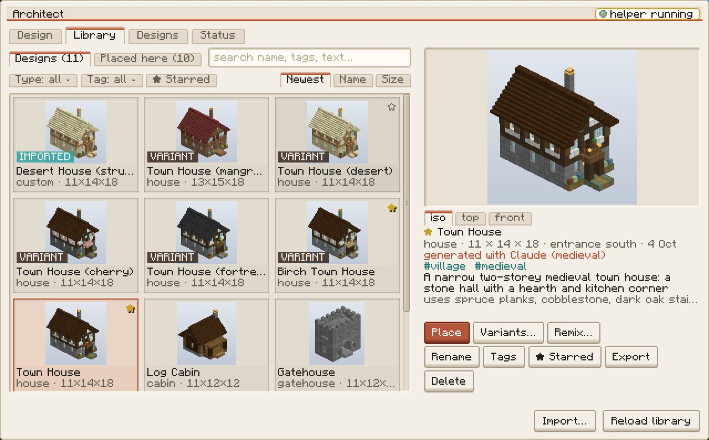

<p align="center">
  
</p>

<p align="center">
  <a href="https://github.com/larattalabs/lab-ui/actions/workflows/ci.yml"></a>
  <a href="LICENSE"></a>
  <a href="https://www.minecraft.net"></a>
  <a href="https://fabricmc.net"></a>
</p>

<p align="center"><sub>Architect's design library, drawn with the Warm Studio screen kit that lab-ui ships.</sub></p>

Lab UI is the shared client UI library of the Laratta Labs Minecraft mods (AgentCraft Worlds, Architect and Steward): one copy of the Warm Studio screen kit, world-space UI and crash guard instead of three drifting ports. It is a Fabric library mod for **Minecraft 26.3** and **Java 25**, moved out of [AgentCraft Worlds](https://github.com/larattalabs/agentcraft-worlds) rather than rewritten.

| | |
|---|---|
| Mod id | `lab_ui` |
| Packages | `dev.larattalabs.labui.*` |
| Maven coordinates | `dev.larattalabs:lab_ui` (GitHub Packages) |
| Resource namespace | `lab_ui` |

## Quick start

### Use it in your mod

The jar is published to GitHub Packages at `https://maven.pkg.github.com/larattalabs/lab-ui`, as `dev.larattalabs:lab_ui:<version>` (latest: `0.4.0`, which adds the [Jobs & spend panel](#jobs--spend-panel-040); `0.3.0` added [on-dark colour tokens and shared HUD zones](#hud-zones-and-on-dark-tokens-030), `0.2.0` the [components](#components-020)).

**1. Get a token.** GitHub Packages' Maven registry needs one **even for public packages**: a token with the `read:packages` scope (a classic personal access token, or your GitHub CLI login). With the GitHub CLI:

```sh
gh auth refresh -s read:packages
export GITHUB_ACTOR=$(gh api user --jq .login) GITHUB_TOKEN=$(gh auth token)
```

Or put them in `~/.gradle/gradle.properties` as `gpr.user` / `gpr.key`.

**2. Add the repository and the dependency** to your `build.gradle` (Loom 1.18 with the non-remapping `net.fabricmc.fabric-loom` plugin, the same setup as the three mods), and set `lab_ui_version=0.4.0` in `gradle.properties`:

```groovy
repositories {
	maven {
		name = "LabUi"
		url = uri("https://maven.pkg.github.com/larattalabs/lab-ui")
		credentials {
			username = providers.gradleProperty("gpr.user").orElse(providers.environmentVariable("GITHUB_ACTOR")).getOrElse("")
			password = providers.gradleProperty("gpr.key").orElse(providers.environmentVariable("GITHUB_TOKEN")).getOrElse("")
		}
		content { includeGroup "dev.larattalabs" }
	}
}

dependencies {
	// Minecraft 26.x is unobfuscated, so the non-remapping Loom has no mod* configurations:
	// use plain `implementation` (`modImplementation` does not exist there and fails the build).
	implementation "dev.larattalabs:lab_ui:${project.lab_ui_version}"
	include "dev.larattalabs:lab_ui:${project.lab_ui_version}"    // jar-in-jar: ships inside your mod jar
}
```

With `splitEnvironmentSourceSets()`, `implementation` covers both `main` and `client`. The pure classes (`dev.larattalabs.labui.ui.*`) can be used from `main`. Everything under `dev.larattalabs.labui.client.*` is client-only.

`include` nests only `lab_ui-<version>.jar`. Fabric API and the loader stay your own dependencies.

**3. Declare the range** in your `fabric.mod.json`. Then a clash between two mods that bundle different lab-ui versions becomes a clear loader error, not a `NoSuchMethodError`:

```json
"depends": { "lab_ui": ">=0.4.0 <0.5.0" }
```

**CI in a consumer repo.** Steward's CI already resolves `dev.larattalabs:architect_mc` from GitHub Packages this way: give the workflow `permissions: packages: read`, and set the env `GITHUB_ACTOR: ${{ github.actor }}` and `GITHUB_TOKEN: ${{ secrets.GITHUB_TOKEN }}` for the Gradle step. If a consumer run still gets 401/403 on `lab_ui`, there are two fixes. Either grant that repo access in the package settings (github.com/larattalabs/lab-ui/packages, then "Package settings", then "Manage Actions access"), or use a PAT secret with `read:packages` instead.

### Build it from source

You need git and JDK 25; Gradle comes with the wrapper. On Linux, install any JDK 25 build (for example Eclipse Temurin) so `java` is on your PATH. On macOS with Homebrew, the JDK is keg-only, so point `JAVA_HOME` at it:

```sh
brew install openjdk@25
export JAVA_HOME="$(brew --prefix openjdk@25)"
```

Then:

```sh
git clone https://github.com/larattalabs/lab-ui.git
cd lab-ui
./gradlew build                 # compile, unit tests of the pure classes, jar in build/libs/
./gradlew publishToMavenLocal   # dev.larattalabs:lab_ui:<version> in ~/.m2
```

The first build downloads Minecraft and Fabric, which takes a few minutes. To test a consumer against an unreleased lab-ui, run `publishToMavenLocal` and add `mavenLocal()` to the consumer's repositories.

## How it works

- **Screen kit.** The "Warm Studio" GUI sprites, panels, buttons, scrollbars and style tokens (`Kit`, `Panels`, `UiStyle`, `TextUtil`, `UiBits`).
- **World-space UI.** Billboards, nine-sliced plates, text lift, speech bubbles and face displays (`WorldUi`, `SpeechBubble`, `DisplayDraw`, `ScreenStyle`).
- **Crash guard.** HUD and tick handlers whose failures are logged once and swallowed, so they never crash the game (`Guard`, `GuardedHud`).
- **Components (0.2.0).** Buttons, chips, lists, pickers, sections, tooltips, confirms, a chat pager, the text field and toasts (see [Components](#components-020)).
- **HUD zones and on-dark tokens (0.3.0).** Named HUD zones that every mod registers into, so HUD pieces of different mods
  never overlap each other or vanilla's boss bars, effects and toasts; and colour tokens for text on dark HUD panels and
  in-world plates (see [HUD zones and on-dark tokens](#hud-zones-and-on-dark-tokens-030)).
- **Jobs & spend panel (0.4.0).** A client-side registry every mod publishes its Claude work and cost ledger into, one
  panel over all of it (the K key), and a shared needs-you pill in the HUD (see [Jobs & spend panel](#jobs--spend-panel-040)).

It has no entrypoint, so nothing runs until a consumer calls it (`JobBoard.install()` is what registers the panel key). Since 0.3.0 it has one client mixin config,
`lab_ui.client.mixins.json`: three read-only accessors (vanilla's toasts and boss bars, for the HUD zones), not required, so a
miss in a later Minecraft only loses the vanilla offset. Consumers bundle it jar-in-jar. The pure classes (`dev.larattalabs.labui.ui.*`) have unit tests; the client classes are exercised by the consuming mods.

### One copy at runtime

When several mods bundle lab-ui, Fabric loads **one** copy: the highest version bundled. So:

- **`Guard` state is shared.** Its failure counts and pending `inject`s are global across mods. Prefix every kind with your mod id (`steward.hud`, `architect_mc.tick`). The log line reads "lab_ui: the <kind> handler failed …".
- **Style data comes only from lab-ui's own files.** `Kit` and `UiStyle` read `assets/lab_ui/gui/kit.json`, `assets/lab_ui/gui/ui-style.json` and `assets/lab_ui/palette.json`. A consumer's own copies of those files are no longer read.
- **Breaking changes reach other mods too.** In 0.x a minor bump may break the API. Keep your `depends` range inside one minor version.

### Sprites and their ids

The kit sprites live in lab-ui's own namespace. They sit at `assets/lab_ui/textures/gui/sprites/kit/` and vanilla stitches them into the GUI atlas.

- **New id.** A sprite's id is now `lab_ui:kit/<name>`, e.g. `lab_ui:kit/panel_paper`.
- **Old ids.** Before, it was `agentcraft_worlds:kit/<name>`, `architect_mc:kit/<name>` or `steward_mc:kit/<name>`.
- **Reference them through `Kit`.** Use `Kit.PANEL_PAPER`, `Kit.button(primary, state)`, `Kit.dot(family, halo)`, `Kit.card(status)`, `Kit.progressFill(tint)`, `Kit.progressRing(p)`, `Kit.icon(name)` or `Kit.id(name)`.
- **Or use the id directly.** `LabUi.id("kit/<name>")` works too.

Only code that builds `<yourmod>:kit/...` ids by hand changes, along with any resource pack that overrode them. Agent portraits (`textures/gui/portrait/`) stay in AgentCraft.

## Project structure

```
src/main/java/dev/larattalabs/labui/        LabUi (ids, logger) and ui/: the pure, unit-tested classes (TextDepth, LeaderGaps, Guard,
                                            UiRules, ToastStack, ListNav, ScrollMath, TextMatch, ChipFlow, ConfirmArm, TooltipMath,
                                            PickerMemory, SectionGrid, PickerModel, PageSlice, ChatPager; 0.3.0: HudZone, HudLayout,
                                            ZoneStack, VanillaHudMath, Contrast; 0.4.0: JobRow, JobState, JobCost,
                                            JobBoardModel)
src/client/java/dev/larattalabs/labui/client/
  ui/                                       Kit, Panels, UiStyle, TextUtil, WorldUi, GuardedHud
  hud/                                      UiBits, Toasts, HudZones, VanillaHud
  jobs/                                     JobBoard, JobsScreen, NeedsYouPill (0.4.0)
  text/                                     TextModel, TextFieldView, TextKeys
  widget/                                   Control, Button, Chip, ChipRow, ScrollList, CollapsibleSection, Tooltip, EmptyState,
                                            Confirm, NavKeys, Paint
  picker/                                   PickerEntry, PickerSpec, PickerStore, CompactPicker, PickerScreen
  monitor/                                  DisplayDraw, ScreenStyle
  world/                                    SpeechBubble
src/client/java/dev/larattalabs/labui/mixin/client/   accessors for VanillaHud (lab_ui.client.mixins.json, not required)
src/main/resources/assets/lab_ui/           kit sprites, gui/kit.json, gui/ui-style.json, palette.json, lang/en_us.json (0.4.0)
src/test/java/                              JUnit tests for the pure classes
.github/workflows/                          ci.yml (build, test, jar contents), publish.yml (release tags)
```

## Components (0.2.0)

Immediate-mode, like the rest of the kit: a screen draws each component where its layout puts it every frame (which
records its rect) and forwards its mouse and key events; every event method returns true when it consumed the event. A
`Control` not drawn in the last 250 ms ignores clicks, so a collapsed section's chips need no bookkeeping. Keyboard focus
belongs to the screen: set `focused(true)` on the control that Enter / Space should press. Pure logic lives in
`dev.larattalabs.labui.ui` and is unit-tested.

| Component | API in a line |
|---|---|
| Tokens | `UiStyle.error() warn() ok() mutedText() selected() selectedEdge() focusRing() rowHover() rowHoverEdge() rule() chip() chipEdge() field() titleBar() titleText() danger() dangerText() link()`, from `ui-style.json` `semantic.*` |
| `Button` | `new Button(label, onPress).primary(b).danger(b).number(n)`; `draw(g, font, x, y, mx, my)` or `draw(g, font, x, y, w, h, mx, my)` (h ≥ 18); `Button.paint(...)` without a control |
| `Chip` | `new Chip(label, onPress).selected(b).kind(NORMAL \| MORE).swatch(rgb).icon(stackSupplier)`; 18 px; `draw(g, font, x, y, mx, my)` returns the width |
| `ChipRow` | `new ChipRow(chips).maxRows(n).onMore(hiddenCount -> …)`; `draw(g, font, x, y, w, mx, my)` returns the height; overflow folds into "+N" (tooltip lists the rest) |
| `ScrollList<T>` | `new ScrollList<>(rowH, painter).filter(text, placeholder).empty(line).onActivate(c).onSelect(c).items(list)`; `draw(g, font, x, y, w, h, mx, my)`; wheel, draggable bar, arrows, Home/End, PgUp/PgDn, Enter / double click |
| `CollapsibleSection` | `new CollapsibleSection(key, title, defaultOpen).summary("8 on: …")`; `draw(...)` returns 16; `open()`; state remembered by key on disk (`config/lab_ui/pickers.json`), the caller's default until first folded |
| `Tooltip` | one per screen: `offer(control, mx, my)` / `offer(key, text)` while drawing, `draw(g, font, mx, my)` last; `Tooltip.render(...)` draws one now; delayed, clamped to the screen |
| `EmptyState` | `new EmptyState(line).action(label, run)`; `draw(g, font, x, y, w, h, mx, my)` centred |
| `Confirm` | `new Confirm(arm, key, label, verb, onConfirm)`; first press arms ("Press again to delete (4)"), second confirms; `escape()` and clicks elsewhere cancel; keyed `ConfirmArm` for row lists |
| `CompactPicker` | `new CompactPicker(spec)`; current, recents, recommended (3 chips) and "more… N", which opens `PickerScreen` |
| `PickerScreen` | `new PickerScreen(spec, parent)`: search (focused), Favourites, Tags / Compare placeholders, Recent strip, family rail, grouped cells or cards, detail pane, Pick / Favourite; names wrap to 2 lines (full name in a tooltip); cells and cards widen to fill the row; Enter picks; Esc clears a typed search, then goes back |
| `PickerSpec` / `PickerEntry` | `PickerSpec.of(id, title, entries).current(id).recommended(ids).groupOrder(groups).layout(CELLS \| CARDS).noun(n).pickLabel(l).detailPreview(p).onPick(c)`, plus `onTags(hook)` / `onCompare(hook)`, which enable those chips (disabled placeholders until set); `PickerEntry.of(id, label).group(g).tags(t).swatch(rgb).icon(s).preview(p).subtitle(s).details(supplier).attr(k, v)` |
| `PickerStore` | recents and favourites per picker id, and `CollapsibleSection` open states, in `config/lab_ui/pickers.json` (`PickerMemory`); prefix ids and keys with your mod id |
| `ChatPager` (common) | `ChatPager.of(lines).pageSize(8).page(p).filter(f).pageCommand(n -> cmd).filterCommand(prefix).build()`: the page plus "…and K more · page 2/5 [‹ prev] [next ›] [filter…]" |
| `TextModel`, `TextFieldView`, `TextKeys` | the kit text field (moved from Architect and Steward, unchanged) |
| `Toasts` | `Toasts.install()` once per mod (one shared stack), `Toasts.push(level, title, body[, key, verb])`, `Toasts.avoid(rectSupplier)`; 0.3.0 `push(Spec)`; 0.4.0 `Spec.ref(rowId)` |

## HUD zones and on-dark tokens (0.3.0)

### On-dark tokens

The `semantic.*` tokens are for text on paper and come out about 2:1 on a dark HUD panel. `UiStyle.OnDark` is the set for
dark surfaces: the HUD ink panel (`Kit.TOOLTIP`), nameplates, dark monitors (`ScreenStyle.dark`) and a walnut slate. Every
text token is at least 4.5:1 on each of them as drawn, also with the 90%-opaque HUD panel over a white world or the sky;
`OnDarkContrastTest` recomputes this from `ui-style.json` (`semantic_on_dark`, `semantic_on_dark_contrast`).

| `UiStyle.OnDark.` | Colour | Worst case | Use |
|---|---|---|---|
| `text()` | #F4EFE6 | 9.30 | body text |
| `muted()` | #C4BDB2 | 5.71 | secondary text, key hints (`UiBits.hints(onDark)`) |
| `error()` | #F2948B | 4.76 | refusals, errors |
| `warn()` | #F2B66A | 5.92 | cautions (amber: a different hue from error) |
| `ok()` | #B8CBB3 | 6.20 | ready, done |
| `accent()` | #80D2CD | 6.09 | notes, links |
| `selected()`, `selectedFill()` | #E6C659, that at alpha 0x30 | 6.38 | a selected or armed choice |
| `focus()` | #C9A227 | 4.40 (a mark, needs 3) | the focus ring |
| `bar()`, `track()` | #2FA3A0, `muted` at 0x60 | 3.48 (a mark) | progress |
| `panel()`, `panelEdge()`, `rule()` | #2B2927, #4A4642, #4A423B | surfaces | the panel, its rim, chip edges and hairlines |

Architect's `HudInk` maps onto these: `text`, `soft`→`muted`, `error`, `warn`, `ok`, `note`→`accent`, `armed`→`selected`,
`bar`, `track`, `chipEdge`→`rule` (error and warn change value; the rest are HudInk's colours).

### HUD zones

A mod registers a HUD piece once into a zone; every frame lab-ui's one HUD element (`lab_ui:hud/zones`) asks each piece
its size, lays the zones out (pure `HudLayout`, unit-tested) and calls each piece's `draw` with its rect. Immediate-mode
like the rest of the kit: the pieces keep no state in lab-ui, they say what they are and draw where they are told.

```java
HudZones.add(MyMod.id("status"), HudZone.TOP_LEFT, new HudZones.Element() {
	String text;
	public HudZones.Size measure(Font font, HudZones.Frame f, int maxW) {      // null = not shown this frame
		text = TextUtil.ellipsize(font, status(), maxW - 12);
		return HudZones.Size.of(font.width(text) + 12, 12);
	}
	public void draw(GuiGraphicsExtractor g, Font font, HudZones.Frame f, HudZones.Slot s) {
		UiBits.dotPill(g, font, "thinking", text, s.x(), s.y(), UiBits.ink());
	}
}).priority(60);
```

| Zone | Where | Anchor |
|---|---|---|
| `BOTTOM_CENTER` | centred, stacking up from 64 px above the bottom; never over the crosshair (on a short screen the floor drops to just above the hotbar) | laid out first: aimed panels never move for anything |
| `TOP_CENTER` | centred, stacking down below vanilla's boss bars, to the crosshair | starts below "Now playing" and (0.3.1) vanilla's toasts when its widest piece reaches them |
| `TOP_LEFT` | x 6, stacking down below vanilla's "Now playing" toast; each piece's `maxW` ends at the toast column or the top-centre pieces and boss bars beside it | answering wider than `maxW` moves the piece below them |
| `TOP_RIGHT_TOASTS` | the toast column (196 wide, 6 from the right), below vanilla's toasts and effect icons, in the first free run between the pieces other zones placed in it | `Toasts` is its priority-0 element. A piece's `minH` here is a claim: it is placed before the top-centre pieces that cross the column, which start below it and collapse first. `Toasts` claims a need-you toast's title row, so one is never folded away; info toasts claim nothing and may fold into "+N more" |
| `LEFT`, `RIGHT` | the edges, centred on the middle | nothing uses them yet |

- **Priority** (default 50): higher sits nearer the zone's anchor edge and shrinks or hides last.
- **Size**: `Size.of(w, h)` is fixed (placed even when it overflows, never hidden silently); `.shrinkTo(minH)` may get any
  height down to `minH` (`slot.collapsed()` = draw the short form); `.optional()` may be hidden when even `minH` does not fit.
- **F1 and screens**: Fabric draws HUD elements only while the HUD is shown, so zone pieces hide with F1. Under an open
  screen a piece is hidden unless `.whileScreenOpen(true)`. `HudZones.hudHidden()` and `screenOpen()` answer anywhere.
- **Crash guard**: each `measure` and `draw` runs in `Guard` under the piece's id.
- **QA**: `HudZones.json()` (each zone's bounds, slots by id, hidden pieces, overflow and vanilla's pieces) and `rect(id)`.
- **Vanilla's pieces** (`VanillaHud`): boss bars (12 + 19 per bar, to a third of the screen), effect icons (beneficial row at
  y 1, the others 26 lower), toasts (`ToastManager`'s visible instances) and "Now playing" (top left, 30 tall). Toasts and
  boss bars have no public accessor in 26.3, so the accessor mixins read them; "Now playing" is read by reflection (its
  field's type is package-private). A failed read is logged once and that piece counts as absent.

### What changed in 0.3.0

Additive: every 0.2.0 class and method is unchanged. Seams:

- **`Toasts.install()`** now installs `HudZones` and adds the stack as `lab_ui:toasts` in `TOP_RIGHT_TOASTS` (priority 0),
  drawn by `lab_ui:hud/zones`; the 0.2 element `lab_ui:hud/toasts` is no longer registered, and the toasts' `Guard` kind is
  `lab_ui:toasts` (was `lab_ui.hud.toasts`). The stack starts below vanilla's toasts and effect icons (it started at y 8
  over them) and ends above whatever other zones place in its column. `Toasts.avoid(rect)` keeps its meaning (the stack
  ends 4 px above the highest such rect) and also feeds `HudZones.avoid(TOP_RIGHT_TOASTS, rect)`. A `new Toasts()` that a
  mod registers by hand still draws the 0.2 stack at the fixed top right.
- **`Toasts.Spec` and `push(Spec)`**: `Spec.of(level, title, body).hint(key, verb).bodyLines(1-3).subject(prefix)`. The
  subject (a prefix of the title, e.g. a settlement's name) is shortened first: "Stilt Swamp Fishing… needs you", not
  "Stilt Swamp Fishing Village nee…" (`ToastStack.fitTitle`, from Steward's toasts; it falls back to the plain ellipsis
  when the rest would leave the subject under 30 px). The existing `push` overloads keep two body lines and no subject.
- **Re-routed through tokens, same colours**: `SpeechBubble`'s @name colour (`UiStyle.link()`), `UiBits.focusRing`
  (`UiStyle.focusRing()`), `UiBits.hints(onDark)` (`OnDark.muted()`), the toasts' WARN title (`UiStyle.error()`).
  `WorldUi`, `DisplayDraw` and `ScreenStyle` had no raw colours to route.
- **Composite builds**: lab-ui's `classes` (and runtime `resources`) variants now carry the client source set too. A
  consumer that `includeBuild()`s a lab-ui checkout and compiles against that variant (Gradle's choice for a project
  dependency) resolves `dev.larattalabs.labui.client.*` without forcing the jar. Consumers that force the jar (Architect,
  AgentCraft) are unaffected.
- **Differences from DRAFT-0.3** (docs/DRAFT-0.3.md): the zone enum is `dev.larattalabs.labui.ui.HudZone` (common code, so
  the pure layout can use it) rather than `HudZones.Zone`; `Size`'s flag is `hideable` (its builder stays `optional()`);
  there is no `whenHudHidden` (Fabric never draws HUD elements under F1); `Toasts.Spec` replaces the positional
  `maxBodyLines` overload (Steward's review).
- **A need-you toast outranks status lines** (coordinator, after the GUI-4 shots): the toasts claim a need-you toast's
  title row ahead of the top-centre pieces; when the column is short, the toast draws as its title row only
  (`ToastStack.layoutNeedFirst`), and the rest count on "+N more" when that fits.

## Jobs & spend panel (0.4.0)

One panel for all the Claude work the Laratta Labs mods do for the player: Architect's designs, sets, bibles, massings and
variants beside Steward's settlement builds, talk and part offers. It shows what each costs against its budget, what a
usage limit holds and what waits for the player, and each row links back into its own mod. The design is Architect's
`docs/JOBS-PANEL.md`; the look is the approved mock.

```java
// onInitializeClient: idempotent, one key and one pill however many mods call it
JobBoard.install();
JobBoard.name("architect_mc", "Architect");

// whenever your jobs change (any thread): replaces this mod's rows, never another mod's
JobBoard.publish("architect_mc", List.of(
	JobRow.builder("architect_mc:massing/m7", "massing", "Market stall v2", JobState.NEEDS_YOU)
		.step("Massing ready: 4 masses, standing in the world").spent(0.31).budget(2, "job").created(startedAt)
		.parent("steward_mc:settlement/12")                      // folds under Steward's settlement row, when it is published
		.link("Architect · Designs tab", () -> openDesigns("m7"))  // Open / Enter: the panel closes, then this runs
		.approve("Approve massing", () -> MassingReview.approve("m7"))
		.cancel("Cancel", () -> cancel("m7"))                    // through the panel's two-press Confirm
		.build()));
// one entry per distinct Claude job; the totals sum this, never the rows
JobBoard.publishLedger("architect_mc", List.of(JobCost.of("job-9f2", "steward_mc:settlement/12", 0.31, chargedAt)));

// a toast about a row: "[K] see it", and K opens the panel on that row while the toast shows
Toasts.push(Toasts.Spec.of(Toasts.Level.NEED, "Willow Bend needs you", "3 massings wait for you.").ref("steward_mc:settlement/12"));
```

| Class | API in a line |
|---|---|
| `JobBoard` (client) | `install()`, `publish(mod, rows)`, `publishLedger(mod, costs)`, `name(mod, displayName)`, `hostOnly(mod, b)`, `showPill(b)`, `open(rowId)`, `openFromKey()`, `keyLabel()`, `key()`, `model()`, `json()` |
| `JobsScreen` (client) | `new JobsScreen(parent, rowId)` (or `JobBoard.open`); `filter(Filter)`, `groupBy(GroupBy)`, `selectedRow()`, `debugState()` |
| `NeedsYouPill` (client, internal) | `lab_ui:jobs_pill` in `TOP_LEFT` (priority 70, optional): "N jobs need you · <first title> [K]" |
| `JobRow` | `JobRow.builder(id, kind, title, state).step(s).needsYou(b).spent(usd).budget(usd, kind).held(reason, resetAtMs).link(label, run).created(ms).ended(ms).parent(id).approve(label, run).cancel(label, run).raise(label, run).build()`; `waiting()` |
| `JobState` | `NEEDS_YOU, RUNNING, QUEUED, HELD, PAUSED_BUDGET, DONE, FAILED, CANCELLED`; `ended()`, `label()` |
| `JobCost` | `JobCost.of(jobId, owner, usd, atMs)`; `ownerMod()` (the owner's namespace, else the publishing mod) |
| `JobBoardModel` (pure, tested) | the registry (`publish`, `publishLedger`, `rows`, `ledger`, `row`, `nameOf`, `version`) and the logic: `roots`, `descendants`, `waitingUnder`, `group`, `lines(rows, filter, groupBy, modName, folded, expanded)`, `counts`, `waitingRoots`, `needsYouCount`, `pillText`, `held`, `resetAt`, `totals(ledger, now, zone)`, `spendText`, `usd`, `budget`, `age` |

- **Rows are global by id.** Use `<modid>:<thing>` ids. A row whose `parent` names a published row folds under it (one level
  in the list; deeper descendants fold under the same root). Until the parent is published the row stands on its own, so
  the order in which mods publish does not matter.
- **The panel decides nothing.** Open, Approve, Raise and Cancel run the owning mod's callbacks; the row changes when that
  mod publishes again ("Sent to Architect. The row changes when Architect answers."). Approve shows only while the row
  waits for the player.
- **Needs you.** A row waits when `needsYou` is set or its state is `NEEDS_YOU` (never once ended). A root waits when it or
  anything under it waits, and counts once: the pill, the header and the Needs you chip all count roots.
- **Spend.** The header total is today's (the local day) sum of the ledger, labelled "estimate". Entries with the same job
  id count once (the latest charge wins) whichever mod publishes them; the split per mod goes by the owner's namespace, so a
  Steward-owned job that Architect runs counts as Steward's. Row and group figures attribute cost only.
- **Held.** While any row is `HELD`, a banner says when Claude work resumes (the soonest `resetAt` still ahead).
- **Layout.** Title bar with the key hints; total, per-mod split and the needs-you count; the banner; chips All / Needs
  you / Running / Held / Ended with counts and Group by State / Mod; the list (group heads fold, remembered under
  `lab_ui.jobs.<group>` in `config/lab_ui/pickers.json`; a root's children show while it or one of them is selected);
  the detail pane (state, step, what waits under it, spend against budget, its Claude jobs, times, where Open goes, the
  actions). Empty states: no work yet; "Claude work runs in the host's game" when a mod said `hostOnly`; "Nothing in
  <filter> right now" with Show all. Lines that do not fit above the actions are left out whole, never cut.
- **Keys.** The panel key `key.lab_ui.jobs` (Options > Controls > Key Binds > Lab UI) is K by default. K is free in
  Minecraft 26.3's defaults (they use G for quick actions, O for friends, P for social interactions, L for advancements;
  F3+K is not a debug combo) and in both mods (Architect B/J, Steward Y/I/U). In the panel: arrows move, Enter opens the
  row in its mod (on a group head: folds it), A approves, K or Esc closes (Esc disarms an armed Cancel first). The key
  does nothing while another screen is open.
- **Toast refs.** `Toasts.Spec.ref(rowId)`: with no hint of its own the toast hints "[K] see it" (the key as bound), and
  `Toasts.refShown()` is the ref of the topmost toast on screen. Only drawn toasts count, not queued ones.
- **Pill.** Hidden when nothing waits, under F1 and screens, and with `JobBoard.showPill(false)`; it is optional in its
  zone, so it gives way when the top left is full. Steward's own HUD line is meant to give way to it.

## Migrating from AgentCraft Worlds, Architect or Steward

### Class map: from AgentCraft Worlds (`dev.agentcraft.*`)

| AgentCraft Worlds | lab-ui |
|---|---|
| `dev.agentcraft.ui.TextDepth` | `dev.larattalabs.labui.ui.TextDepth` |
| `dev.agentcraft.ui.LeaderGaps` | `dev.larattalabs.labui.ui.LeaderGaps` |
| `dev.agentcraft.ui.Guard` | `dev.larattalabs.labui.ui.Guard` |
| `dev.agentcraft.client.ui.WorldUi` | `dev.larattalabs.labui.client.ui.WorldUi` |
| `dev.agentcraft.client.ui.GuardedHud` | `dev.larattalabs.labui.client.ui.GuardedHud` |
| `dev.agentcraft.client.ui.Kit` | `dev.larattalabs.labui.client.ui.Kit` |
| `dev.agentcraft.client.ui.Panels` | `dev.larattalabs.labui.client.ui.Panels` |
| `dev.agentcraft.client.ui.UiStyle` | `dev.larattalabs.labui.client.ui.UiStyle`: no `agentOnDark` / `agentOnLight` |
| `dev.agentcraft.client.ui.TextUtil` | `dev.larattalabs.labui.client.ui.TextUtil` |
| `dev.agentcraft.client.hud.UiBits` | `dev.larattalabs.labui.client.hud.UiBits`: no agent-name or portrait helpers |
| `dev.agentcraft.client.monitor.DisplayDraw` | `dev.larattalabs.labui.client.monitor.DisplayDraw` |
| `dev.agentcraft.client.monitor.ScreenStyle` | `dev.larattalabs.labui.client.monitor.ScreenStyle`: no `name(agentId)` |
| `dev.agentcraft.client.agents.SpeechBubble` | `dev.larattalabs.labui.client.world.SpeechBubble`: `Addressees` seam |
| `AgentCraft.id(...)`, `AgentCraft.LOGGER` (as used by these classes) | `dev.larattalabs.labui.LabUi.id(...)`, `LabUi.LOGGER` |

### Class map: from Architect (`dev.larattalabs.architect.*`) and Steward (`dev.larattalabs.steward.*`)

Steward's kit is a port of Architect's, which is a port of AgentCraft's. Both match lab-ui except for the package and namespace.

| Architect / Steward | lab-ui |
|---|---|
| `<mod>.client.ui.Kit` | `dev.larattalabs.labui.client.ui.Kit` |
| `<mod>.client.ui.Panels` | `dev.larattalabs.labui.client.ui.Panels` |
| `<mod>.client.ui.UiStyle` | `dev.larattalabs.labui.client.ui.UiStyle`: identical API |
| `<mod>.client.ui.TextUtil` | `dev.larattalabs.labui.client.ui.TextUtil` |
| `<mod>.client.ui.GuardedHud` | `dev.larattalabs.labui.client.ui.GuardedHud` |
| `<mod>.client.hud.UiBits` | `dev.larattalabs.labui.client.hud.UiBits`: identical API |
| `<mod>.ui.Guard` | `dev.larattalabs.labui.ui.Guard` |
| `<mod>.ui.UiRules` (0.2.0) | `dev.larattalabs.labui.ui.UiRules`: identical API |
| `<mod>.ui.ToastStack` (0.2.0) | `dev.larattalabs.labui.ui.ToastStack`: identical API |
| `<mod>.client.text.TextModel`, `TextFieldView`, `TextKeys` (0.2.0) | `dev.larattalabs.labui.client.text.*`: identical API |
| `<mod>.client.hud.Toasts` (0.2.0) | `dev.larattalabs.labui.client.hud.Toasts`: see "What changed in 0.2.0" |
| Architect's `OwnedConfirm`, CrateScreen's Deconstruct two-press | `ConfirmArm` (keyed, pure) and the `Confirm` button |

Here `<mod>` is `dev.larattalabs.architect` or `dev.larattalabs.steward`. Not in lab-ui, so keep your own: `HasParent` and `ScreenPause` (they read each mod's own environment).

### What changed in the move

Behaviour is unchanged apart from these seams.

**Namespace.** Every `agentcraft_worlds:` identifier is now `lab_ui:`. This covers the kit sprites, the internal render-pipeline names (`lab_ui:pipeline/world_ui_solid`, `lab_ui:pipeline/displays_solid`) and the dynamic white texture (`lab_ui:dynamic/displays_white`). `kit.json` is rewritten to match.

**`UiStyle` and `UiBits` take Architect's trimmed form.**
- `UiStyle` drops `agentOnDark` / `agentOnLight`, which fell back to AgentCraft's cast.
- `UiBits` drops `nameOnLight`, `nameOnDark`, `isUser`, `userName`, `agentName`, `hasPortrait`, `face` and `framedPortrait`, which read the Foreman and the cast.
- AgentCraft keeps these in a helper of its own.
- `ui-style.json` still carries the `agents.*` tokens, so `UiStyle.color("agents.<id>.text_on_dark")` works.

**`ScreenStyle.name(agentId)` is dropped** because it called `agentOnDark` / `agentOnLight`. AgentCraft's monitors pick the agent colour themselves.

**`SpeechBubble` is decoupled from AgentCraft's protocol and cast.**
- **Show calls.** `show(AgentSay, age)` is now `show(text, to, ts, age)`, and `showLate(AgentSay, age, ticksAgo)` is now `showLate(text, to, ts, age, ticksAgo)`.
- **Addressees.** "@name" resolution goes through the `SpeechBubble.Addressees` interface (`name(id)`, `color(id)`; null means the default), passed to `new SpeechBubble(addressees)`. With `Addressees.NONE` the bubble shows the id in `paper.link`.
  - "user" is still the local player's name.
  - "all", null and "" still get no prefix.
- **Visibility.** The members that used to be package-private are now public: `tick`, `clear`, `visibility`, `layout`, `stackHeight`, `submit`, `prefix` and `TEXT_LIFT`.
- **AgentCraft's resolver.** It keeps the old behaviour by returning the Foreman agent's name, and `UiStyle`-agentOnLight for cast members.

**`Guard`'s log line** starts with `lab_ui:` instead of `AgentCraft:`.

### What changed in 0.2.0 (the moves from Architect and Steward)

Both mods had the same copies of these files. Behaviour is unchanged apart from these seams.

- **`TextModel`, `TextFieldView`, `TextKeys`, `UiRules`, `ToastStack`.** Only the package changed (`TextKeys` now calls
  `dev.larattalabs.labui.ui.UiRules`), and the Javadoc of `UiRules` is worded for any mod.
- **`Toasts`: one stack for every mod.** Fabric loads one lab-ui copy, so its toast list is shared. Call `Toasts.install()`
  (idempotent) instead of registering your own HUD element: it registers `lab_ui:hud/toasts` once, guarded by
  `Guard` kind `lab_ui.hud.toasts`. Registering `new Toasts()` yourself as well would draw every toast twice.
- **`Toasts`: the placement-HUD dodge is a seam.** Architect's toasts stopped above `BuildPlacement.hudRect()`. Now each
  mod adds its own rect with `Toasts.avoid(() -> rect)` (`{x, y, w, h}` or null), and the stack ends 4 px above the
  highest one. Architect keeps its behaviour with `Toasts.avoid(BuildPlacement::hudRect)`; Steward adds nothing (it had
  none). `lastText()`, `shown()` and `json()` are unchanged for QA.

### Not in lab-ui (yet)

These are AgentCraft-shaped and have no small seam that would make them generic without changing behaviour.

| Class | Why it stays out |
|---|---|
| `PlateStack`, `Nameplate`, `PlateLayout` | Bound to `AgentRenderState`, `AgentLife` and agent roles. |
| `HudLayout`, toasts, `HudSounds` | Foreman listeners. |
| `StatusMap`, `DisplayText` | Foreman task and decision types. |
| AgentCraft's `UiRules` | Agent targeting, lecterns and `Anchors` are mixed in with the generic rules. The generic Enter / two-press / `KeyRepeat` rules shipped in 0.2.0 as `dev.larattalabs.labui.ui.UiRules` (Architect's and Steward's copy). |

## Versioning

Semantic versioning. In 0.x a minor bump (0.1 → 0.2) may break the API; a patch never does.

The version lives in `gradle.properties` (`mod_version`).

**To release:** bump it on `main`, wait for CI to go green, then push the tag `v<mod_version>`. The Publish workflow checks that the tag matches `mod_version`, then builds and publishes `dev.larattalabs:lab_ui:<version>` (jar and sources jar) to GitHub Packages.

## License

[MIT](LICENSE) © Laratta Labs · Built by [Laratta Labs](https://larattalabs.com). Based on [AgentCraft](https://github.com/blendi-remade/agentcraft).

LICENSE carries two copyright lines: AgentCraft contributors, for upstream AgentCraft by blendi-remade, and Laratta Labs, for the changes made in AgentCraft Worlds and lab-ui. [NOTICE](NOTICE) lists which files come from upstream AgentCraft, which were written in the fork, and where the sprites and style data come from. The kit PNGs are upstream's Warm Studio art, byte-identical.

Both files ship inside the jar, so they travel with every jar-in-jar copy. Keep them when you redistribute.
